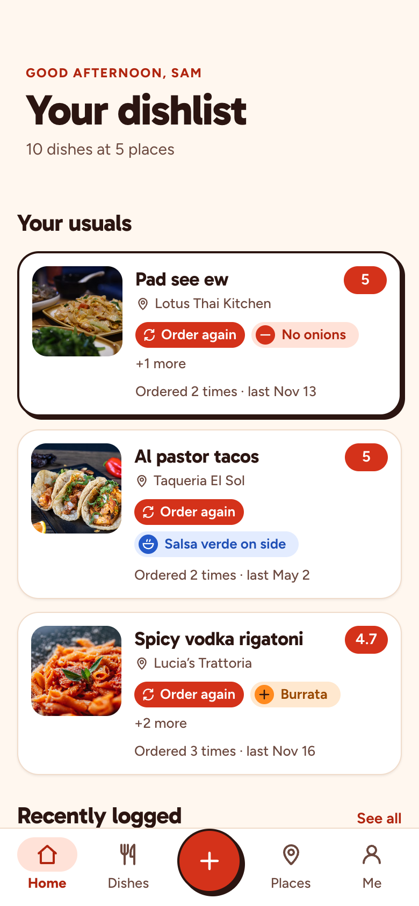
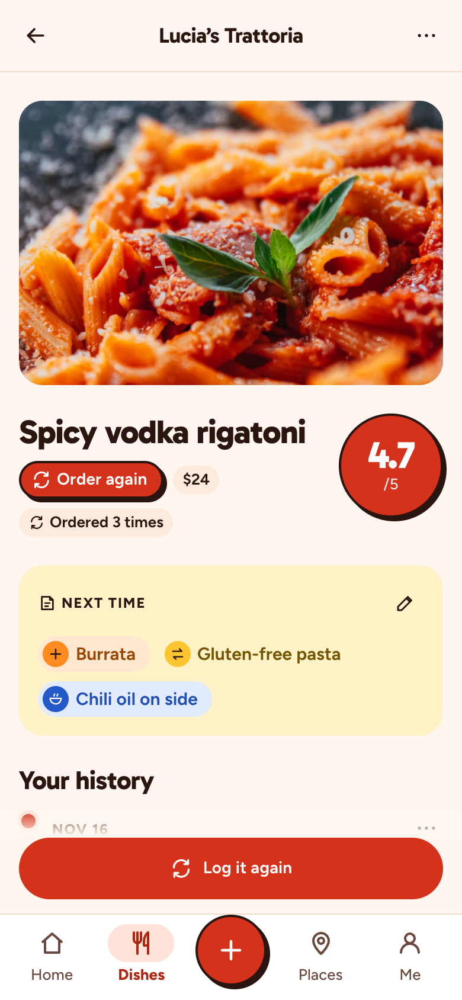
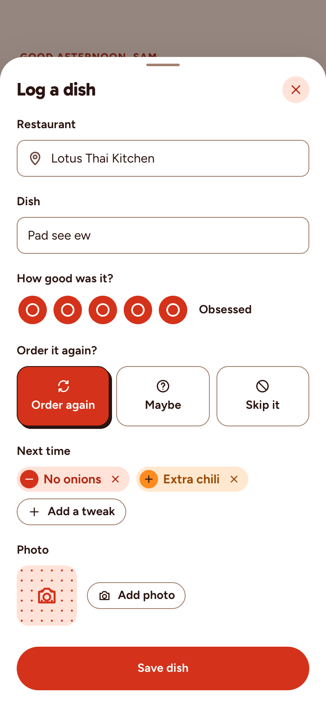
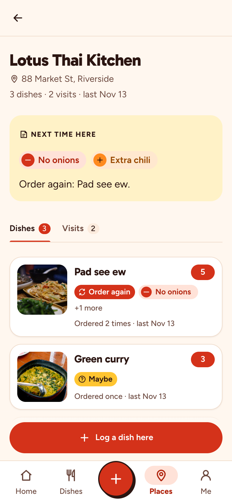
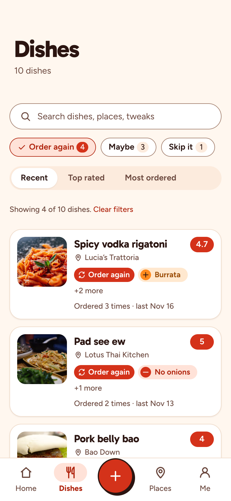
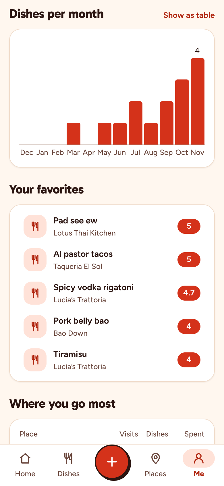
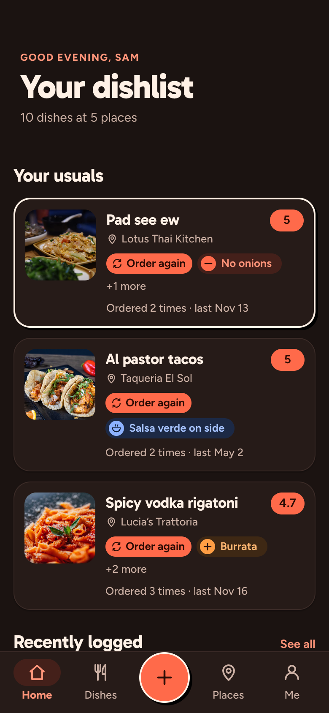
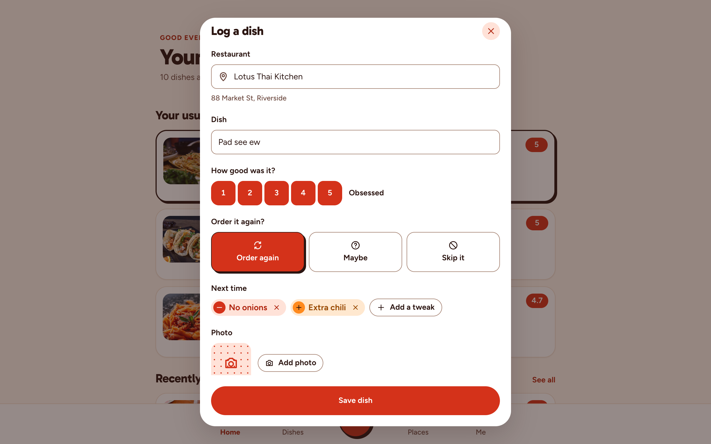
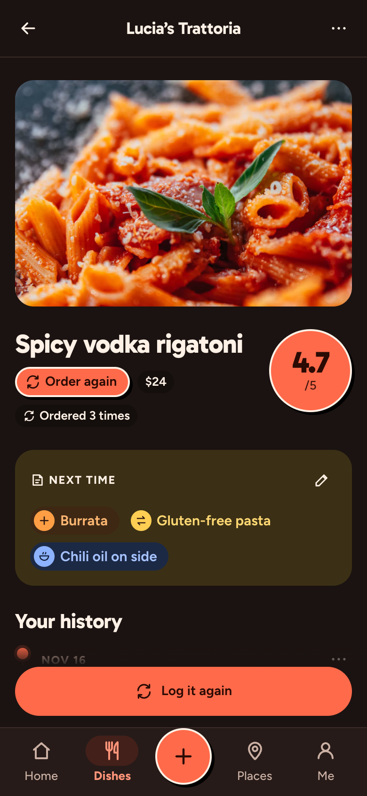
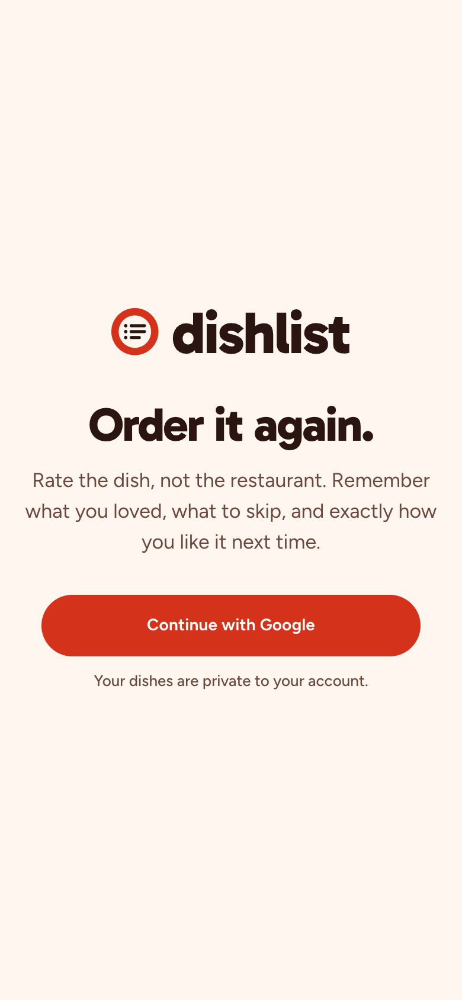

# Dishlist

**Rate the dish, not the restaurant.** Dishlist remembers what you ordered, how good it was, whether you'd order it again, and exactly how you like it ("no onions, extra chili").

<p align="center">
  
  
  
</p>

A React + Firebase progressive web app: installable, works offline, light and dark themes, with its own design system.

---

## Product brief

### The problem

Review apps rate **restaurants**. But you don't eat a restaurant, you eat a dish. The same place can serve your favorite pad see ew and a mango sticky rice you never want again, and a 4.2-star average tells you neither.

Six months later, back at that place, the questions you actually have are:

- What did I love here?
- What should I skip?
- How did I order it? (No onions? Sauce on the side?)

Notes apps and photo rolls technically hold that information, but nobody searches them at the table.

### Who it's for

People who eat out often and keep going back to the places they like: regulars who want "the usual" to be easy, adventurous orderers who forget what they tried, and anyone with a standing tweak (allergies, spice level, swaps) they're tired of re-explaining.

### Goals

1. **Remember the dish.** Every rating, verdict and note belongs to a dish, never to a restaurant.
2. **Remember how to order it.** "Next time" tweaks are the signature feature and show up wherever you'd need them.
3. **Log in seconds.** One button, one sheet, and logging a dish you've had before fills in last time's details.
4. **Answer "what should I order here?"** at the table, in one glance.
5. **Work in a basement with no signal.** Private to you, available offline, syncing when you're back online.

### Non-goals

- Public reviews, followers, or social feeds
- Restaurant discovery, maps, or reservations
- An averaged "restaurant score" (deliberately never shown)
- Nutrition or calorie tracking

### Core ideas

| Concept | What it means |
| --- | --- |
| **Dish** | Everything you've logged for the same dish at the same place. It has its own average rating, times ordered, and history. |
| **Plates** | Ratings are 1 to 5 plates: Nope, Meh, Fine, Good, Obsessed. The word always shows, so a rating never depends on counting icons. |
| **Verdict** | The one-glance answer to "would I order this again?": Order again, Maybe, or Skip it. Skipping is neutral, never red: disliking a dish is information, not an error. |
| **Tweak** | How you want it next time, written the way you'd say it to a server: *No onions*, *Extra chili crisp*, *Rice for noodles*, *Sauce on the side*. |
| **Place** | A restaurant summed up by its dishes: what to order again, what to skip, and every tweak for your next visit. |

### Key flows

<table>
<tr>
<td width="33%" valign="top"></td>
<td valign="top">

**Log a dish.** The tomato button in the tab bar opens one sheet: restaurant, dish, plates, verdict, tweaks, photo, price, notes. Restaurant and dish names autocomplete from your history. Type a dish you've had before and its verdict and tweaks fill themselves in. Photos are resized on the phone before upload, and errors are written as fixes ("Pick a restaurant so we can file this dish").

</td>
</tr>
<tr>
<td valign="top"></td>
<td valign="top">

**Look a dish up before you order.** The dish page is ordered by what matters: how much you liked it, whether to order it again, how to order it ("Next time"), then every visit. **Log it again** reopens the sheet with everything filled in.

</td>
</tr>
<tr>
<td valign="top"></td>
<td valign="top">

**Walk into a restaurant.** The place page leads with a **Next time here** note collecting every tweak and must-order for that restaurant, then its dishes (best first) and a visit timeline.

</td>
</tr>
<tr>
<td valign="top"></td>
<td valign="top">

**Find anything.** Search across dishes, restaurants, notes and tweaks; filter by verdict; sort by recent, top rated, or most ordered.

</td>
</tr>
<tr>
<td valign="top"></td>
<td valign="top">

**See your habits.** Dishes per month, spending, favorites by their own average rating, and the places you go most (by visits, never by an averaged score).

</td>
</tr>
</table>

### Details that matter

- **Undo, not "are you sure?"** Deleting shows an Undo toast, and photos are only removed once the undo window closes.
- **Offline first.** The app shell is cached by a service worker and your dishes by Firestore's offline cache. Changes made offline show "Waiting to sync" until they reach the server, and signing out warns you if anything hasn't synced yet.
- **Private by default.** Firestore and Storage security rules limit every read and write to the owner, and they're tested on the Firebase emulators in CI.
- **Accessible.** Every control has a visible label or an accessible name, focus rings meet contrast in both themes, and ratings and verdicts always pair an icon with a word.

### If this were a product: what I'd measure

- Time to log a dish (target: under 30 seconds)
- Share of logs with a verdict or a tweak (is the core idea landing?)
- Repeat logs created with **Log it again** (is the dish memory useful?)
- Place pages opened on a return visit (is "Next time here" useful at the table?)

### What's next

- Share a list with a friend ("what's good at Lotus?")
- Reminders when you're near a place with a "Next time" note
- Import past meals from your camera roll

---

## Screenshots

| Light | Dark | Desktop |
| --- | --- | --- |
|  |  |  |
|  |  |  |

<sub>Screenshots use sample data. The food photos are from [Unsplash](https://unsplash.com) under the Unsplash License: [pad see ew](https://unsplash.com/photos/ycTZg-1XC9U), [rigatoni](https://unsplash.com/photos/iXzStLbERMk), [tacos](https://unsplash.com/photos/Zggo6DP_P88), [bao](https://unsplash.com/photos/pfQe8jnme0g), [green curry](https://unsplash.com/photos/JTTxGQaFZKw), [mango sticky rice](https://unsplash.com/photos/bKrXKkPkhas), [breakfast burrito](https://unsplash.com/photos/1r_k74aEK58), [tiramisu](https://unsplash.com/photos/kBRJ6dhhmYQ). In the app, the only photos are the ones you take.</sub>

---

## How it was built

This project is an experiment in building software with AI. I set the product direction, made the calls, and reviewed every change. [Claude Code](https://claude.com/claude-code) did the implementation, ran the tests, and checked its work in a real browser.

**November 2024: a weekend prototype.** I generated the first version with [Bolt.new](https://bolt.new): a basic meal log with star ratings. It never fully worked. The deploy served a blank page, the database rules blocked every write, and photos broke Firestore's 1 MB document limit.

**November 2026: brought back with Claude Code**, one reviewable pull request at a time:

| PR | What it did |
| --- | --- |
| [#3](https://github.com/pmschartz/dishlist/pull/3) | Assessed the old code, then fixed the blank deploy, the CI that wiped its own config, the type errors, and the security rules. Removed the Bolt scaffolding. |
| [#4](https://github.com/pmschartz/dishlist/pull/4) | Upgraded everything two years out of date: React 18→19, Vite 5→8, Firebase 10→13, Tailwind 3→4, ESLint 9→10. Audit findings went from 35 to 4. |
| [#5](https://github.com/pmschartz/dishlist/pull/5) | Moved photos to Firebase Storage with in-browser resizing, fixed a bug where meals without a price never saved, and added the first test suite. |
| [#6](https://github.com/pmschartz/dishlist/pull/6) | Editing, search and filters, and offline support with a live data subscription. |
| [#7](https://github.com/pmschartz/dishlist/pull/7) | Installable PWA that opens offline, emulator tests for the security rules, a stats page, and a 64% smaller login bundle. |
| [#10](https://github.com/pmschartz/dishlist/pull/10) | Redesigned the whole app around the Dishlist design system and its dish-first product ideas. |

**The design system.** Before the redesign, I worked with Claude to create **Dishlist**, a design system covering brand voice, color and type tokens (light and dark), a custom icon set, logos, and about 40 components. Claude Code then ported it into this codebase: `src/design/` holds its tokens and styles, and `src/ui/` holds the components.

**How I kept it honest.**
- Every change landed as a pull request with CI: lint, type check, unit and integration tests, security rules tests on the emulators, and a Firebase preview deploy.
- Claude Code verified UI changes in a real browser, at phone and desktop sizes and in both themes, before opening each PR.
- Product decisions stayed mine: where photos live and what that costs, which features to build, adopting the design system, and what to cut.

---

## Tech stack

- **App:** React 19, TypeScript, Vite 8, vite-plugin-pwa (Workbox)
- **Backend:** Firebase 13: Authentication (Google), Firestore with a persistent offline cache, Storage, Hosting
- **Restaurant search:** [Photon](https://photon.komoot.io) (OpenStreetMap data, no API key). Your location is rounded to about 1 km before it's sent, and only while you're typing a restaurant name
- **Design:** the Dishlist design system: generated CSS tokens, Gabarito and Figtree (SIL OFL), a custom icon set, no CSS framework
- **Quality:** Vitest and Testing Library (90 tests), Firebase emulator tests for the security rules, ESLint with React Compiler rules, GitHub Actions CI, Dependabot

```
src/
├── app/              # App shell (navigation, toasts, sign-out), router, update prompt
├── screens/          # Home, Dishes, Dish, Places, Place, Me, Log a dish sheet, Login
├── ui/               # Dishlist design system components, ported to typed React
├── design/           # Design tokens (tokens.json → tokens.css), component CSS, fonts, logos
├── contexts/         # Auth context, provider, and useAuth hook
├── lib/              # Firebase setup, dish grouping, stats, filtering, formatting, image resizing
├── services/         # Reading and writing meals and photos
├── types.ts          # Shared TypeScript types
└── App.tsx           # Login screen or the signed-in app
tests/rules/          # Security rules tests (run on the Firebase emulators)
docs/screenshots/     # README images
firestore.rules       # Firestore security rules
storage.rules         # Storage security rules
```

## Running it yourself

You need Node.js 20.19+ or 22.12+ and a Firebase project.

```bash
git clone https://github.com/pmschartz/dishlist.git
```
```bash
cd dishlist && npm install
```

Create a `.env` file with your Firebase web config (it's never committed):

```env
VITE_FIREBASE_API_KEY=your_api_key
VITE_FIREBASE_AUTH_DOMAIN=your_auth_domain
VITE_FIREBASE_PROJECT_ID=your_project_id
VITE_FIREBASE_STORAGE_BUCKET=your-project.firebasestorage.app
VITE_FIREBASE_MESSAGING_SENDER_ID=your_messaging_sender_id
VITE_FIREBASE_APP_ID=your_app_id
```

Then start the dev server at `http://localhost:5173`:

```bash
npm run dev
```

### Firebase setup

1. Create a project in the [Firebase console](https://console.firebase.google.com) and enable Google sign-in under Authentication.
2. Create a Firestore database.
3. Set up Cloud Storage for photos. New projects need the Blaze (pay-as-you-go) plan for Storage; personal use normally stays within the no-cost allowance.
4. Deploy the security rules (each user can only read and change their own dishes and photos):

```bash
npx firebase deploy --only firestore:rules,storage
```

### Scripts

| Command | What it does |
| --- | --- |
| `npm test` | Unit and integration tests (`npm run test:watch` to re-run on changes) |
| `npm run test:rules` | Security rules tests on the Firebase emulators (needs Java 21+; uses a `demo-` project, never your real one) |
| `npm run typecheck` / `npm run lint` | Type check / lint |
| `npm run build` / `npm run preview` | Production build / serve it locally (the service worker only runs in a production build) |
| `npm run generate-tokens` | Regenerate `src/design/tokens.css` after editing `tokens.json` |
| `npm run generate-icons` | Regenerate the app icons from `public/icon.svg` |

## License

[MIT](LICENSE). Fonts: [Gabarito](https://fonts.google.com/specimen/Gabarito) and [Figtree](https://fonts.google.com/specimen/Figtree) under the SIL Open Font License (see `src/design/fonts/`).
